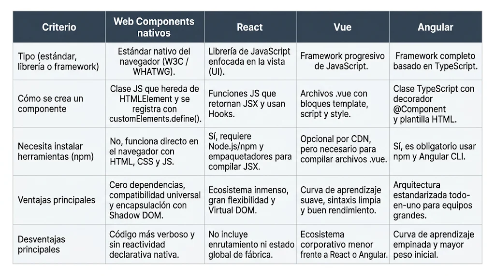

# Investigación: Web Components, HTML Templates y Frameworks

## 1. ¿Qué problema resuelven los Web Components y qué aporta cada tecnología: Custom Elements, Shadow DOM y HTML Templates?
Los Web Components resuelven la falta de un estándar nativo en la web para crear elementos de interfaz reutilizables y encapsulados sin depender de librerías o frameworks externos, evitando conflictos de estilos y scripts en proyectos grandes. Custom Elements permite definir nuevas etiquetas HTML personalizadas con su propio comportamiento y ciclo de vida en JavaScript. Shadow DOM crea un árbol DOM aislado para el componente, encapsulando su estructura y estilos CSS para que no afecten ni sean afectados por el resto de la página. Por su parte, HTML Templates (`<template>`) permite declarar fragmentos de marcado HTML inertes que el navegador no renderiza hasta que son clonados e instanciados dinámicamente con JavaScript.

## 2. ¿En qué se diferencia un `<template>` de un `
` oculto con `display: none`?
Aunque ambos son invisibles para el usuario en pantalla, un `
` con display: none sigue formando parte activa del DOM: el navegador descarga sus imágenes, ejecuta sus etiquetas `<script>`, aplica reglas Css y responde a consultas globales como "document.querySelector()". En cambio, el contenido de un `<template>` permanece completamente inerte en un fragmento de documento separado "(`DocumentFragment`)" hasta que se clona e inserta explícitamente. Por ello, dentro de un `<template>` no se cargan recursos multimedia ni se ejecutan scripts, y "document.querySelector()" no encontrará sus elementos internos buscando directamente en el documento principal.

## 3. ¿Qué cambia entre el Shadow DOM en modo `"open"` y en modo `"closed"`?
La diferencia radica en el nivel de accesibilidad externa hacia el árbol interno del componente desde el JavaScript de la página principal. Cuando se crea con attachShadow({ mode: 'open' }), cualquier script externo puede acceder e inspeccionar la raíz del Shadow DOM mediante la propiedad elemento.shadowRoot. Por el contrario, al usar attachShadow({ mode: 'closed' }), la propiedad elemento.shadowRoot devuelve null hacia el exterior, bloqueando la manipulación directa desde fuera y permitiendo que únicamente el código interno del propio componente conserve una referencia privada para modificarlo.

## 4. ¿Qué es un `<slot>` y para qué sirve en un componente reutilizable?
Un `<slot>` es un marcador de posición (espacio reservado) dentro de la estructura del Shadow DOM de un Web Component que permite proyectar contenido HTML externo enviado por el usuario entre las etiquetas de apertura y cierre del componente. Sirve para hacer los componentes mucho más flexibles y reutilizables, ya que permite personalizar partes variables —como textos, íconos o botones adicionales— sin alterar la estructura ni los estilos encapsulados del componente. Además, permite definir múltiples espacios identificados mediante el atributo "name" e incluir contenido por defecto si el usuario no proporciona ninguno.

## 5. ¿Qué navegadores soportan hoy los Web Components?
Actualmente, las especificaciones principales de los Web Components (Custom Elements v1, Shadow DOM v1 y HTML Templates) cuentan con soporte nativo y completo en todos los navegadores modernos de escritorio y móviles: Google Chrome, Mozilla Firefox, Apple Safari, Microsoft Edge y Opera (además de Chrome para Android y Safari en iOS). Esto significa que funcionan de forma nativa sin necesidad de *polyfills* en más del 96 % de los navegadores utilizados a nivel mundial. (Fuente: Can I use - Custom Elements / Shadow DOM)

---

# Parte 2. Investigación: frameworks, librerías y Node.js

## 1. Diferencia entre estándar del navegador, librería, framework y entorno de ejecución
* Estándar del navegador: Es una especificación oficial implementada de forma nativa por los navegadores web sin instalar código de terceros. Ejemplo: Web Components o la API fetch(), que funcionan directamente en Chrome o Firefox.
* Librería: Es un conjunto de funciones o herramientas específicas que el desarrollador importa y llama cuando las necesita, manteniendo el control de la arquitectura del proyecto.
* Framework: Es un marco de trabajo integral que impone una arquitectura, reglas y flujo de ejecución propios; bajo el principio de inversión de control, el framework es quien llama al código del desarrollador.
* Entorno de ejecución: Es el software que proporciona los recursos y motores necesarios para ejecutar código fuera de su entorno tradicional, como ejecutar JavaScript directamente en un servidor o computadora.

## 2. Tabla comparativa

## 3. ¿Qué es Node.js, para qué se usa y qué relación tiene npm con React, Vue y Angular?
Node.js es un entorno de ejecución (runtime) de JavaScript de código abierto y multiplataforma construido sobre el motor V8 de Google Chrome, el cual permite ejecutar código JavaScript fuera del navegador web. Se utiliza principalmente para desarrollar servidores web, APIs REST, microservicios, herramientas de línea de comandos y automatización de tareas de desarrollo.

La relación de npm (Node Package Manager) con React, Vue y Angular es fundamental: aunque estas tres herramientas se ejecutan finalmente en el navegador del cliente, durante el desarrollo dependen de Node.js y npm para descargar sus paquetes, gestionar dependencias y ejecutar herramientas de compilación, transpilación (de JSX o TypeScript a JavaScript estándar) y empaquetado (como Vite o Webpack) antes de subir la aplicación a producción.

En una tienda en línea que usa React y Node.js:
* React (Frontend): Se encarga de toda la interfaz visual con la que interactúa el comprador en su navegador: mostrar el catálogo de productos, aplicar filtros, gestionar el carrito de compras de forma dinámica y renderizar el formulario de pago sin recargar la página.

* Node.js (Backend): Se encarga de la lógica del servidor y la seguridad: procesar las peticiones que envía React, consultar y actualizar el inventario en la base de datos, autenticar usuarios, calcular totales reales y comunicarse de forma segura con las pasarelas de pago.

## 4. Elección y justificación de herramienta por caso

a. Un botón de chat que varias empresas pegan en sus propias páginas:
* Web Components nativos.
Al tratarse de un componente aislado que se incrustará en sitios web externos construidos con tecnologías desconocidas (WordPress, React, Angular o HTML puro), los Web Components garantizan compatibilidad total sin obligar a los clientes a instalar librerías pesadas. Además, el Shadow DOM protege los estilos del botón de chat para que el CSS de la página anfitriona no lo deforme ni viceversa.

b. Una aplicación web grande para un banco, con muchos equipos de desarrollo:
* Angular.
En un entorno bancario con múltiples equipos trabajando en paralelo, Angular ofrece una arquitectura estandarizada y estricta respaldada por TypeScript que obliga a todos los desarrolladores a seguir las mismas convenciones. Al incluir de fábrica enrutamiento, seguridad, formularios reactivos e inyección de dependencias, se reduce la fragmentación técnica y se facilita el mantenimiento y las auditorías a largo plazo.

---

## Fuentes consultadas

* Todas las fuentes fueron consultadas el 17 de noviembre de 2026.

1. MDN Web Docs — Web Components: https://developer.mozilla.org/es/docs/Web/API/Web_components 

2. MDN Web Docs — Uso de plantillas y ranuras (`<template> y <slot>`): https://developer.mozilla.org/es/docs/Web/API/Web_components/Using_templates_and_slots 

3. Node.js Official Documentation — Introducción a Node.js: https://nodejs.org/en/learn/getting-started/introduction-to-nodejs 

4. React Official Documentation — Quick Start & Describing the UI: https://react.dev/learn 

5. Angular Official Documentation — What is Angular?: https://angular.dev/overview 

6. Can I use — Custom Elements (v1) & Shadow DOM (v1): https://caniuse.com/custom-elementsv1 